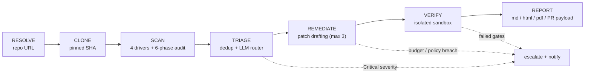

<div align="center">

```text
    _    ____  ____   _______   __  ___
   / \  |  _ \/ ___| / / ____| / / / _ \
  / _ \ | |_) \___ \/ /|  _|  / / | | | |
 / ___ \|  _ < ___) / /| |___/ /__| |_| |
 /_/   \_\_| \_\____/_/ |_____/_____\___/
```

**Autonomous Engine for Guarding, Inspecting & Securing**

A self-hosted security-automation pipeline that audits any Git repository,
triages every finding, drafts **sandbox-verified** fixes and ships them as a **pull request**.

[](LICENSE)
[](https://nextjs.org)
[](https://www.typescriptlang.org)
[](https://prisma.io)
[](https://socket.io)
[](CONTRIBUTING.md)

`RESOLVE → CLONE → SCAN → TRIAGE → REMEDIATE → VERIFY → REPORT`

</div>

---

## Why AEGIS

Most "AI security scanners" hand the whole job to a model and hope. AEGIS takes the opposite stance:

| Principle | How it is enforced |
|---|---|
| **Deterministic scanners set ground truth** | gitleaks / bandit / semgrep / pip-audit rule semantics run as vendored TypeScript drivers behind one normalized finding schema — plus a vendored six-phase source audit. The LLM never decides what counts as a finding. |
| **LLM drafts, never adjudicates** | A model-agnostic router (Groq → platform bridge → deterministic heuristic fallback) classifies severity and suppresses false positives. Every decision records reasoning + confidence; detection truth stays with the scanners. |
| **Every mutation is verified** | Patches apply in an ephemeral, credential-free sandbox: exact-match application, the repository's own pytest suite, a targeted re-scan (per-rule occurrence must decrease) and a protected-path policy gate. |
| **PR-only delivery** | AEGIS never merges and never writes to protected branches. Critical fixes are escalated for mandatory human review. |
| **Runs always terminate** | Budget and wall-clock caps are checked before every remediation attempt; a breach escalates with full attempt history and the run still delivers a (partial) report. |

## The pipeline



Two modes, chosen at run time: `report-only` and `auto-fix` (with sandbox verification).

## The console

A terminal-styled operator console streams every run live over Socket.IO:

```text
┌─ AEGIS ▸ run_r7k3m ───────────────────────────── AUTO_FIX ─┐
│ ▸ SCAN       ████████████████████  34 files · 4 drivers    │
│ ▸ TRIAGE     ████████████████████  31 findings · 3 FP      │
│ ▸ REMEDIATE  ███████████████░░░░░  14 patches drafted      │
│ ▸ VERIFY     ██████████░░░░░░░░░░   pytest ✓ · rescan ✓    │
│ ▸ REPORT     ░░░░░░░░░░░░░░░░░░░░   composing…              │
└─────────────────────────────────────────────────────────────┘
```

- **Dashboard** — KPIs, severity mix, auto-fix rate, time-to-report, cost
- **Live console** — seven-stage pipeline, streaming events, paste-to-audit launcher
- **Findings explorer** — filter by severity / tool / status, per-finding evidence and verified diffs
- **Escalation queue** — human-review hand-off with full attempt history
- **Report center** — Markdown / HTML / PDF export and the staged PR payload
- **Command palette** — `Ctrl+K` everything; execution logs replayable per run

## Quick start

Requirements: Node 20+ / Bun 1.1+, Python 3.12 (sandbox test gate), SQLite (bundled).

```bash
git clone https://github.com/Ahmad-fahim-dev/aegis-autofix.git
cd aegis-autofix

bun install                # install dependencies
cp .env.example .env       # configure (all optional — see Configuration)
mkdir -p db && bun run db:push   # create the SQLite schema at db/custom.db
bun run dev                # console on http://localhost:3000
```

Start the realtime event stream in a second terminal:

```bash
cd mini-services/aegis-realtime
bun install && bun run dev         # Socket.IO on :3001
```

Open `http://localhost:3000`, paste a repository URL into the launcher — the audit starts
automatically, streams live through the seven stages, and lands in the report center.
Try the bundled fixtures first: `sample://vuln-blog` or `sample://clean-service`.

## CLI

`scripts/aegis` is a zero-dependency operator CLI (bash + curl + jq) for a running instance:

```bash
export AEGIS_BASE_URL=http://127.0.0.1:3000

scripts/aegis scan sample://vuln-blog --mode auto-fix --wait
scripts/aegis status <runId>
scripts/aegis report <runId> --format md
scripts/aegis runs | stats | escalations
scripts/aegis help
```

## CI

`.github/workflows/aegis.yml` runs scheduled or manual-dispatch audits as a thin HTTP client
against a self-hosted engine: multi-repo matrix, bounded polling (429-aware), Markdown report
artifacts. Set `AEGIS_ENDPOINT` + `AEGIS_TOKEN` (read + PR-creation scope only) as repository
secrets.

## REST API

| Method | Route | Purpose |
|---|---|---|
| `GET` | `/api` | Liveness probe — engine admission state, uptime |
| `POST` | `/api/runs` | Start an audit (`repoUrl`, `mode`); 429 when 2 runs already active |
| `GET` | `/api/runs` | List runs (summaries, filters) |
| `GET` | `/api/runs/:id` | Run detail — findings, attempts, events |
| `GET` | `/api/runs/:id/report?format=md\|html\|pr` | Markdown / HTML / PR-payload report |
| `GET` | `/api/escalations` | Human-review queue |
| `POST` | `/api/escalations/:id` | Approve / reject with note (idempotent) |
| `GET` / `PUT` | `/api/settings` | Runtime overrides — model, budgets, protected paths |
| `GET` | `/api/stats` | Aggregate KPIs for the dashboard |

## Sample targets

Any public (or credential-accessible) GitHub URL is shallow-cloned and pinned to an exact
commit. Two fixtures ship in-repo for offline demos:

- **`sample://vuln-blog`** — Flask app with ~30 planted issues: hardcoded AWS/Stripe/DB
  secrets, SQL injection, command injection, weak MD5 hashing, insecure `pickle` /
  `yaml.load`, TLS verification disabled, CVE-pinned dependencies, and an offline pytest suite.
- **`sample://clean-service`** — mostly-clean payments service with three residual hygiene
  findings and one documented false positive.

## Safety model

- Never merges; never writes to protected branches; PR-only delivery.
- Repository token scoped to **read + PR creation only**.
- Untrusted repo code runs only in the isolated sandbox — no network egress, no credentials,
  ephemeral filesystem, bounded runtime, `no-new-privileges`.
- Secrets are redacted before any external model call (fail-closed masking) and re-bound only
  inside the sandbox.
- Budgets checked before every attempt — a run always terminates with a report.

The full audit trail (six-phase automated audit + manual triage of every attack surface) is
published in [SECURITY-AUDIT.md](SECURITY-AUDIT.md).

## Configuration

| Variable | Purpose | Default |
|---|---|---|
| `DATABASE_URL` | SQLite file URL for the event + findings store | `file:../db/custom.db` |
| `GROQ_API_KEY` | Optional OpenAI-compatible key (Groq). Empty = fully self-hosted deterministic engine | unset |
| `GROQ_MODEL` | Model id (whitelist enforced in `src/lib/aegis/groq.ts`) | `llama-3.3-70b-versatile` |
| `AEGIS_BRIDGE_TOKEN` | Shared secret for the realtime `/broadcast` bridge (fail-closed when unset) | unset |
| `AEGIS_NOTIFIER` | Pluggable notifier for Critical alerts | `console` |

Runtime overrides (key, model, budgets, protected paths) can also be set from the console's
Settings dialog — stored in the `Setting` table, taking precedence over the environment.

## Data model

Event-sourced by design — every scan, prompt, response, patch and test result is recorded
and replayable (Prisma + SQLite):

| Model | Role |
|---|---|
| `Run` | One pipeline execution: repo, mode, status, cost, wall-clock |
| `Finding` | Lifecycle `DETECTED → TRIAGED → (SUPPRESSED \| VERIFIED \| ESCALATED) / REPORTED` |
| `RemediationAttempt` | One patch draft + sandbox verification (max 3 per finding) |
| `Escalation` | Hand-off to the human-review queue with reason + resolution |
| `Event` | Append-only run log (stage, level, payload) |
| `LlmCall` | Per-stage cost / latency / degraded-mode telemetry |
| `Setting` | Runtime configuration overrides |

## Repository layout

```text
src/lib/aegis/        engine, drivers, triage, remediation, sandbox, policy, redaction, notifier, reporter
src/lib/aegis/audit/  vendored six-phase source audit (runner, hunters, ledger, verify, report)
src/app/api/          REST API — runs, report, stats, escalations, settings
src/components/aegis/ terminal-styled console UI (launcher, live pipeline, findings, reports, dashboards)
prisma/schema.prisma  Run / Finding / RemediationAttempt / Escalation / Event / LlmCall / Setting
mini-services/        aegis-realtime — Socket.IO event stream (:3001)
scripts/aegis         operator CLI
samples/              vulnerable + clean fixture repositories
deploy/Caddyfile      hardened reverse-proxy gateway config
.github/workflows/    CI integration
Dockerfile            sandbox image for patch verification (Python 3.12, non-root)
```

## Sandbox & Docker

The sandbox image pins Python 3.12 + pytest + scanner tooling on a non-root user:

```bash
docker build -t aegis-sandbox:1.0.0 .
docker run --rm --network none --read-only --tmpfs /sandbox:rw,size=64m,exec \
  --pids-limit 64 --cpus 1 --memory 512m --security-opt no-new-privileges \
  -v "$(pwd)/repo-snapshot:/sandbox/repo" aegis-sandbox:1.0.0
```

Without a Docker daemon, the engine verifies patches in a local throwaway, credential-free
directory (`/tmp/aegis-sandbox/attempt-*`) with the same four gates and the same pytest
entry point.

## Tech stack

| Layer | Choice |
|---|---|
| Runtime | Next.js 16 (App Router) · React 19 · TypeScript 5 |
| Styling | Tailwind CSS 4 · shadcn/ui · Framer Motion |
| State | TanStack Query · Zustand |
| Realtime | Socket.IO (dedicated mini-service) |
| Storage | Prisma ORM · SQLite |
| AI routing | OpenAI-compatible (Groq) with deterministic fallback |

## Verification

```bash
bun run lint        # ESLint (Next.js + TypeScript rules)
bunx tsc --noEmit   # type check
scripts/aegis scan sample://vuln-blog --mode report-only --wait
scripts/aegis scan sample://vuln-blog --mode auto-fix --wait
scripts/aegis report <runId> --format md
```

## Honest limitations

- **Language focus**: scanner drivers reimplement gitleaks/bandit/semgrep/pip-audit rule
  semantics in-engine (Python-first) and are pluggable; the vendored six-phase audit runs as a
  fifth driver. The Dockerfile ships the native scanner stack for sandbox deployments.
- **LLM triage degrades honestly**: without a reachable model endpoint the engine records
  `LLM_DEGRADED` events and falls back to the deterministic heuristic engine.
- **PR creation**: the payload is fully composed (title, body, verified diffs, review
  statements); pushing a branch requires a GitHub token with read + PR-creation scope.
- **Out of scope (v1)**: dynamic analysis, IaC scanning, auto-merge, hosts other than GitHub.

## Roadmap

- [ ] Native Docker-sandbox verification in CI runners
- [ ] Additional drivers (ESLint-security, gosec, trivy)
- [ ] Diff-aware incremental scans
- [ ] Multi-tenant workspaces + SSO

## Contributing

Issues and pull requests are welcome — see [CONTRIBUTING.md](CONTRIBUTING.md).
Security reports follow the policy in [SECURITY.md](SECURITY.md).

## License

Released under the [MIT License](LICENSE) — © Ahmad Fahim.
